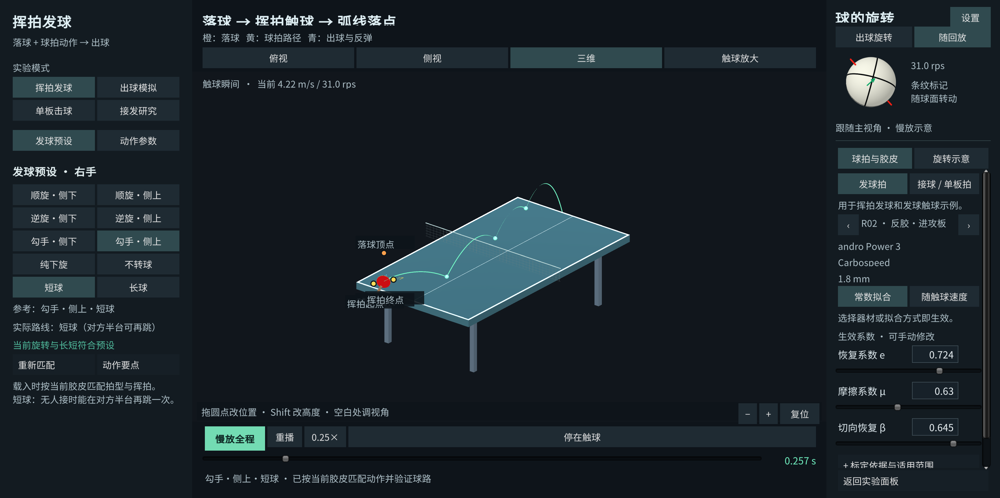
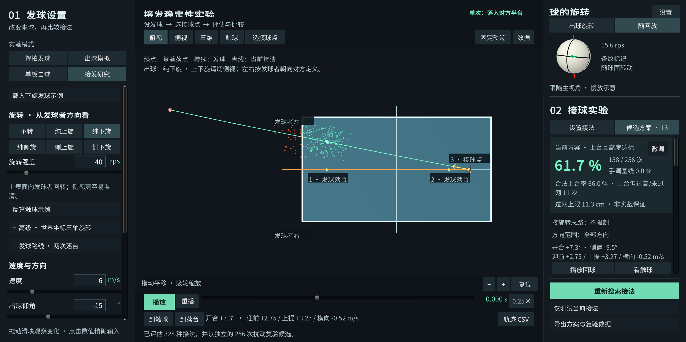
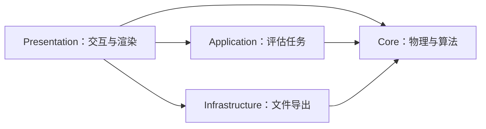

# 乒乓球物理试验场

用拍型、挥拍和来球旋转做可重复的乒乓球实验：观察弧线与落点，比较不同接法在误差下的上台率和过网高度。基于 Unity 6.3 LTS，物理核心使用独立的 C# 模型；目前专注击球与接发研究，尚未包含多人、回合制或完整角色动作。

[使用说明](#1-使用说明) · [截图与功能](#2-截图与功能介绍) · [代码与模块](#3-代码目录与模块介绍) · [物理模型](#4-物理模型与计算方法) · [参考资料](#5-参考资料及其作用)

## 1. 使用说明

### 在线体验（Web）

**[打开浏览器版：pinggo.willer.tech/tts/](https://pinggo.willer.tech/tts/)**

无需安装。电脑使用鼠标；手机会切换为触屏布局，支持横竖屏、双指缩放和数值输入弹层。报告在浏览器中下载为 ZIP；Safari 若未自动开始下载，可点击页面底部的下载链接。

首次加载需要下载约 19 MB 资源。已通过桌面 Chrome、手机尺寸触屏配置下的输入／接发搜索／导出检查，以及 iPhone 模拟器 Safari 的加载与渲染检查；尚未在实体 iPhone 上验证性能和完整交互。

### 下载与安装

普通使用者直接下载 Windows 构建包，无需安装 Unity Editor，也无需 Unity 账号。

- [最新 Release](https://github.com/willerhehehe/tabletennis-simulator/releases/latest)
- [v0.1.2 · Windows 11 x64 下载（约 44.8 MB）](https://github.com/willerhehehe/tabletennis-simulator/releases/download/v0.1.2/TableTennisLab-Windows11-x64-0.1.2.zip)
- [使用说明](https://github.com/willerhehehe/tabletennis-simulator/releases/download/v0.1.2/README-Windows-zh-CN.txt) · [SHA-256 校验文件](https://github.com/willerhehehe/tabletennis-simulator/releases/download/v0.1.2/TableTennisLab-Windows11-x64-0.1.2.zip.sha256)

1. 将 ZIP **完整解压**到桌面、下载目录等可写文件夹。
2. 进入 `TableTennisLab` 文件夹，双击 `TableTennisLab.exe`。
3. 保留同目录的 `TableTennisLab_Data`、`MonoBleedingEdge` 和 DLL；不要只复制 exe，也不要直接在压缩包内运行。

窗口可缩放或最大化，建议使用 1440 × 900 或更大的显示区域。中文字体已随程序附带。Windows 版导出的实验数据保存在程序旁的 `Artifacts/`；如无法导出，请将完整程序目录移到可写位置。

Windows 包使用 x64 / Mono / Direct3D 11，已完成 macOS 交叉构建和压缩包校验；**尚未在 Windows 实机启动验证**。

### 第一次实验：从发球到接发

1. 在「挥拍发球 → 发球预设」选择右手顺旋、逆旋、勾手、纯下旋或不转，再选长球／短球。
2. 打开右上角「设置 → 球拍与胶皮」，选择「发球拍」的器材及拟合模式。**选择即生效**；换胶皮后，可回到预设面板点「重新匹配」。
3. 在「动作参数」调节拍型、挥拍方向与速度；拖动落球顶点、挥拍起点或终点，观察球路。默认自动配合落球安排触球位置和时机。
4. 用「停在触球」「触球放大」观察拍面、触点和摩擦方向；用俯视看落点，侧视看弧线，三维看动作空间关系。
5. 发球先落本方、再落对方半台后，点击「用这个发球研究接法」。手动选择接球点，调整接球拍型与挥拍，再点「仅测试当前接法」或「搜索更稳接法」。

「发球拍」同时用于正向挥拍与发球触球反算；「接球 / 单板拍」用于单板实验和接发评估。两侧器材可以不同，均在同一设置入口管理。

### 常用操作

| 操作 | 用途 |
|---|---|
| 空白处左键拖动 | 三维视角旋转；俯视／侧视平移 |
| 右键／中键拖动，或 Shift + 左键拖动 | 平移视角 |
| 滚轮、画布底部 `− / +` | 缩放；「复位」恢复预设视角 |
| 拖动橙色／黄色控制点 | 改落球位置／挥拍路径；三维中 Shift 拖动只改高度 |
| 空格、R、时间滑条 | 播放／暂停、重播、定位回放时刻；编辑数值时不触发播放快捷键 |
| 点击数值框 | 精确输入参数，支持小数和科学计数法；回车结束编辑 |
| 「选接球点」后点击高亮轨迹 | 选择对方半台弹起后的接球位置；Esc 退出选点 |
| 「设置 → 旋转示意」 | 切换黑点／黑带／网格、跟随视角、暂停与单步观察 |
| 「导出动作与轨迹」／「导出方案与复验数据」 | 保存参数 JSON、球状态与碰撞事件 CSV、接法及逐次试验结果 |

挥拍速度独立于路径长度：拉长路径会增加挥拍时长，不会自动加快挥拍。自动对准触球只是辅助安排位置与时机，不保证任意手调动作都能过网或落台。当前不能通过拖动两个目标落点直接反求发球。

### 从源码运行

使用 **Unity 6.3 LTS（6000.3.23f1）**：

```sh
git clone https://github.com/willerhehehe/tabletennis-simulator.git
cd tabletennis-simulator
```

在 Unity Hub 中添加项目目录，打开 `Assets/Scenes/PhysicsLab.unity` 并点击 Play。Unity CLI 为可选工具，不影响直接通过 Editor 使用。Retina 屏幕如出现低分辨率放大，可使用菜单「乒乓球 → 原生清晰度预览」。

## 2. 截图与功能介绍

### 挥拍发球、旋转与器材



截图为 R02 常数模式下的勾手侧上短球。落球、球拍路径、完整球路和旋转示意同时显示；实际拍型与摩擦决定出球，不用预先画好的曲线代替计算结果。

| 功能 | 可以做什么 |
|---|---|
| **挥拍发球** | 从静止、无旋的落球顶点开始，设置拍面角度、左右朝向、拍柄转角、黑红翻面、路径和速度，由实际碰撞计算出球 |
| **16 个右手发球预设** | 顺旋侧下／侧上、逆旋侧下／侧上、勾手侧下／侧上、纯下旋、不转，各有长短两种；载入时按当前胶皮匹配并验证 |
| **出球模拟** | 直接指定离拍位置、球速、出球仰角和旋转，快速比较弧线、弹台和落点；也可反算一组可能的局部触球动作 |
| **单板击球** | 输入接触瞬间的来球，再调接球拍面与三轴挥拍速度；提供正手拉下旋、反手拧拉下旋及对照动作 |
| **常驻旋转示意** | 在各模式右上角显示带纹理的球、红色旋转轴和绿色转向箭头；默认跟随主视角及当前回放，可固定观察出球旋转 |
| **器材比较** | 10 组整拍常数拟合，其中 5 组反胶支持速度相关响应；手动修改固定系数后明确显示为自定义参数 |

发球预设表达的是**局部触球方案**。例如勾手与逆旋不仅是旋转方向不同，还涉及握拍与动作外观；当前没有完整手腕、手肘、引拍或假动作动画。发球拍面与台面夹角为 0° 水平朝上、90° 竖直、180° 水平朝下；单板／接发面板的“拍面开合”则以竖直为 0°，两种控件的角度基准不同。

### 接发研究与落点分布



截图中的示例使用下旋来球、R02 速度响应和 11.3 cm 的过网高度上限。先固定接球点，再比较动作。你可以只测手调接法，也可以限定「顺旋转接／逆旋转接」和挥拍方向后搜索。结果同时关注**合法上台**与**过网高度达标**，避免只追求上台而忽略冒高风险。

- 主画面球路是无误差的名义结果；候选百分比和落点云来自带误差的多次试验，两者不能混为一谈。
- 选用候选、与手调基线对照、回到参数微调后重测；修改物理条件会使旧统计失效。
- 右上角旋转示意可观察触球前后与弹台后的变化。绿点表示成功落点，橙点表示部分失败球路的台高交点；触网等失败另计入统计。

两张截图均来自实际 Unity 运行界面。显示的球路、转速与成功率属于截图当时的实验条件，不是对所有器材或真实击球的保证。

## 3. 代码目录与模块介绍

```text
Assets/
├── Scenes/PhysicsLab.unity       # 实验场景入口
├── Scripts/
│   ├── Core/                    # 纯 C# 物理、发球与接发算法
│   ├── Application/             # 后台评估任务与取消、结果交接
│   ├── Infrastructure/          # 实验文件与报告导出
│   └── Presentation/            # Unity 界面、触屏、相机和浏览器桥接
├── Plugins/WebGL/               # 浏览器输入与下载桥接
├── WebGLTemplates/TableTennis/   # Web 加载页与画布适配
├── Editor/                      # Editor 验证工具、Windows / Web 构建入口
├── Tests/PhysicsChecks.cs       # 共用物理回归检查
└── Resources/                   # 中文字体及第三方许可
Checks/                          # .NET 8 独立检查入口与数据回放
Calibration/rubber/              # 公开数据快照、拟合脚本、系数和报告
docs/                            # 模块说明、研究资料与截图
scripts/                         # 检查、归档校验、Windows / Web 构建脚本
deploy/nginx/                    # /tts/ 静态服务路由配置
Packages/、ProjectSettings/      # Unity 依赖与项目配置
strategy-demo/                   # 独立网页策略原型，不属于 Unity 运行时
```

### 四个程序集的职责



| 模块 | 主要对象 | 职责 |
|---|---|---|
| [Core](Assets/Scripts/Core) | `BallPhysics`、`ServeStroke`、`ServeContact`、`ServePreset`、`ReceiveStudy`、`InvertedRubberResponse` | 更新球状态、求碰撞与反算动作、匹配发球、评估接法、计算器材响应 |
| [Application](Assets/Scripts/Application) | `ReceiveStudyRunner` | 复制输入快照；桌面后台运行、Web 分批推进；报告进度、处理取消与异常并交回结果 |
| [Infrastructure](Assets/Scripts/Infrastructure) | `ExperimentFiles` | 写入轨迹、碰撞事件、参数和逐次试验报告 |
| [Presentation](Assets/Scripts/Presentation) | `PhysicsLab`、`LabScene`、`LabTheme`、`SpinPreview`、各预设面板 | 绑定控件、切换模式、控制视角与回放，管理场景和显示资源 |

前三个模块通过程序集的 `noEngineReferences: true` 禁止引用 Unity，因此可以脱离 Editor 检查。`PhysicsLab` 的 partial 文件按功能拆分，但仍是同一个界面协调组件；物理算法不在这些界面文件中。详见[模块边界](docs/architecture/模块边界.md)。

### 验证与构建

安装 .NET 8 SDK 后运行：

```sh
sh scripts/check.sh
python3 scripts/check-reference-data.py
```

当前检查包含 116 项核心检查、后台任务与导出验证、1,623 条常数模型测试数据回放及 827 条反胶响应测试数据回放。发球匹配覆盖 5 组反胶 × 2 种拟合模式 × 16 个预设，共 160 个组合。Unity 菜单「乒乓球」提供对应的物理、界面、拖动及预设检查；命令行物理检查不能代替画面和交互验证。

Windows 构建需安装 **Windows Build Support (Mono)**。下面是 macOS 交叉构建示例，版本号应选择尚未构建的新版本：

```sh
UNITY_EDITOR="/Applications/Unity/Hub/Editor/6000.3.23f1/Unity.app/Contents/MacOS/Unity" \
  python3 scripts/build-windows.py --version 0.1.3
```

脚本复制到临时项目构建，保留正在运行的 Editor 实验；输出位于 `Builds/Windows11/<版本号>/TableTennisLab/`。脚本生成程序目录，Release 的 ZIP 需将该目录及使用说明一起压缩。`Library/`、`Temp/`、`Artifacts/`、`Builds/`、本地工具与缓存均不进入 Git。

Web 构建需安装 **Web Build Support**：

```sh
python3 scripts/build-web.py --version 0.2.0
```

输出位于 `Builds/Web/0.2.0/site/`，需要通过 HTTP(S) 服务器访问，不能直接双击 HTML。加载资源使用相对路径，可部署在 `/tts/` 下；nginx 配置和发布步骤见[部署说明](deploy/README.md)。`server-config.env` 仅供本地部署使用，已加入 Git 忽略规则。

Web 不依赖 `Task.Run` 执行接发搜索：每次试验之间可以让出控制权，由界面逐帧推进；桌面与 Web 使用同一随机种子、候选和评分逻辑，一致性、取消及异常处理均有检查。安装 Playwright 后，可运行 `node scripts/check-web-bridge.cjs` 验证输入和下载桥接；`CHROME_BIN` 可指定浏览器路径。

## 4. 物理模型与计算方法

核心使用“**自由飞行积分 → 找到接触时刻 → 施加碰撞冲量 → 继续飞行**”的顺序。Unity 绘制这组计算结果，不再给球叠加另一套 Rigidbody / PhysX 运动。

### 坐标、单位与球体

以球台中心为水平原点：X 向发球者右侧，Y 向上，Z 从发球方指向对面。球台顶面在 Y = 0.76 m。

| 量 | 模型取值或单位 |
|---|---|
| 球半径 $R$、质量 $m$ | 0.02 m、0.0027 kg |
| 球台长 × 宽 × 高 | 2.74 × 1.525 × 0.76 m |
| 网高 | 0.1525 m，高度相对台面 |
| 位置 $\mathbf{x}$、速度 $\mathbf{v}$ | m、m/s |
| 角速度 $\boldsymbol{\omega}$ | 内部及 CSV 用 rad/s；UI 用 rps，1 rps = $2\pi$ rad/s |
| 转动惯量 $I$ | 薄空心球近似，$I=\frac{2}{3}mR^2$ |

上下旋随球的前进方向定义。球沿 +Z 前进时，+X 角速度表示上旋；反向来球不能直接沿用这个符号标签。相机转动只改变观察投影，不修改世界坐标中的速度和旋转。

### 飞行：重力、阻力与马格努斯效应

球的飞行满足：

$$
\dot{\mathbf{x}}=\mathbf{v},\qquad
m\dot{\mathbf{v}}=\mathbf{F}_g+\mathbf{F}_D+\mathbf{F}_M
$$

**重力**使球向下加速，默认 $g=9.81\ \mathrm{m/s^2}$：

$$
\mathbf{F}_g=m(0,-g,0)
$$

**空气阻力**与速度相反，采用常数阻力系数的二次阻力模型。令迎风面积 $A=\pi R^2$：

$$
\mathbf{F}_D=-\frac{1}{2}\rho A C_D\lVert\mathbf{v}\rVert\mathbf{v}
$$

**马格努斯力**用来模拟旋转球的下扎、上托与侧弯。方向为 $\boldsymbol{\omega}\times\mathbf{v}$，升力系数随横向旋转比增加并饱和：

$$
S=\frac{R\lVert\boldsymbol{\omega}\times\mathbf{v}\rVert}{\lVert\mathbf{v}\rVert^2},\qquad
C_L=C_{L,\max}\left(1-\exp\left(-\frac{kS}{C_{L,\max}}\right)\right)
$$

$$
\mathbf{F}_M=\frac{1}{2}\rho A C_L\lVert\mathbf{v}\rVert^2
\frac{\boldsymbol{\omega}\times\mathbf{v}}{\lVert\boldsymbol{\omega}\times\mathbf{v}\rVert}
$$

叉积为零时，马格努斯力为零；球速接近零、或升力上限为零时，代码也单独处理，避免除零。因此沿飞行方向自转的分量，不会凭空生成侧向升力。

自由飞行中的旋转按指数衰减：

$$
\boldsymbol{\omega}(t+\Delta t)=\boldsymbol{\omega}(t)e^{-\lambda\Delta t}
$$

位置与速度使用四阶 Runge–Kutta（RK4）积分，默认步长 0.001 s；各积分阶段使用对应时刻衰减后的角速度。默认参数为 $\rho=1.225\ \mathrm{kg/m^3}$、$C_D=0.47$、$k=0.6$、$C_{L,\max}=0.35$、$\lambda=0.08\ \mathrm{s^{-1}}$。这些气动力参数仍是可调整的经验值，尚未用本项目的独立飞行实测数据标定。

实现：[BallPhysics.Acceleration / Advance](Assets/Scripts/Core/BallPhysics.cs)。

### 球拍与球台：摩擦如何同时改变速度和旋转

球拍和球台共用瞬时冲量模型。令单位法向 $\mathbf{n}$ 从接触面指向球，球心到触点的力臂为 $\mathbf{q}=-R\mathbf{n}$，接触面的速度为 $\mathbf{v}_s$。触点的相对速度是：

$$
\mathbf{u}=\mathbf{v}+\boldsymbol{\omega}\times\mathbf{q}-\mathbf{v}_s,\qquad
u_n=\mathbf{u}\cdot\mathbf{n},\qquad
\mathbf{u}_t=\mathbf{u}-u_n\mathbf{n}
$$

这里既包含球心移动，也包含球面因旋转产生的速度。只在 $u_n<0$、球与表面相向接近时计算碰撞。

法向恢复系数 $e$ 决定弹回程度，法向冲量为：

$$
J_n=-(1+e)m\,u_n
$$

切向恢复系数 $\beta$ 描述接触点切向运动的恢复，摩擦系数 $\mu$ 限制能够传递的切向冲量：

$$
J_t=\min\left(
\frac{(1+\beta)\lVert\mathbf{u}_t\rVert}{1/m+R^2/I},\ \mu J_n
\right),\qquad
\mathbf{J}=J_n\mathbf{n}-J_t\widehat{\mathbf{u}_t}
$$

$\mathbf{u}_t=0$ 时取切向冲量为零。最终同时更新平动与转动：

$$
\mathbf{v}'=\mathbf{v}+\frac{\mathbf{J}}{m},\qquad
\boldsymbol{\omega}'=\boldsymbol{\omega}+\frac{\mathbf{q}\times\mathbf{J}}{I}
$$

在摩擦上限未截断所需冲量时，$\mathbf{u}'_t=-\beta\mathbf{u}_t$：$\beta=-1$ 表示没有切向冲量，$\beta=0$ 表示消除触点滑动，$\beta>0$ 允许切向回弹。触点速度与沿拍面摩擦共同决定回球；模型不会根据“上旋／下旋”标签直接翻转角速度。

球拍是速度已知的无限质量运动表面，能够对球做功；球台表面速度为零。被动能量检查适用于静止表面，不能要求运动球拍击球后球的能量一定下降。实现：[BallPhysics.Contact / Strike](Assets/Scripts/Core/BallPhysics.cs)。

### 球台反弹与碰撞检测

球台默认 $e=0.88$、$\mu=0.20$、$\beta=0$，每次落台都执行上面的冲量更新，**第一跳、第二跳及后续反弹都会重新计算速度与旋转**；某些分量可能保持不变，更新后的状态决定下一段气动力。

是否出现明显的俯视折线，取决于触点的横向滑动，不是只要有“侧旋”标签就必然侧拐。例如纯绕竖直轴旋转时，球底触点满足 $\boldsymbol{\omega}\times\mathbf{q}=0$，这种理想点接触不会仅因该旋转产生横向摩擦冲量；空中侧弯仍可能由马格努斯力造成。

- **球台**：球心下降到“台高 + 球半径”时，在步长内二分求接触时刻，检查球心投影是否在有限矩形台面内，再从碰撞时刻继续积分。未模拟擦边、台板侧面、底面或球壳变形。
- **球拍**：正向发球以移动平面寻找首次相交，并确认触点落在有限椭圆胶皮内；拍柄／拍边击球及碰后第二次击球未建模。
- **球网**：球心路径对按球半径扩张后的网盒作扫掠检测，触网即终止，不模拟网布形变或擦网反弹。
- **终止**：触网、触地、最多四次台面反弹、反弹竖直速度小于 0.03 m/s，或达到设定模拟时长（默认每段最多 4 s）。

球台的摩擦和恢复系数仍待实测标定。碰台筛选对拍面与拍柄使用保守包围盒，会提示或排除可能撞台的动作，但不模拟球拍撞台后的运动。

### 胶皮、海绵与底板：用公开数据拟合整拍响应

真实球拍包含面胶、海绵、胶水和底板。当前模型将这些层的综合作用折算为 $e,\mu,\beta$，**不逐层求解压缩、剪切或振动**；拟合配置对应具体胶皮、厚度和底板组合，不能当作某款胶皮独立于底板的材料常数。

| 模式 | 当前实现 |
|---|---|
| 常数拟合 | 10 组器材各用一组固定 $e,\mu,\beta$；例如 R02 为约 0.724、0.630、0.645 |
| 随触球速度 | R01、R02、R03、R04、R09 五组反胶，每次触球重新计算 $e$ 和 $\beta$；$\mu$ 保持拟合常数 |
| 自定义 | 手动设定固定系数，便于对照与敏感性实验 |

速度响应使用法向撞击速度 $a=\max(0,-u_n)$ 和滑动速度 $b=\lVert\mathbf{u}_t\rVert$。先将输入夹在训练覆盖范围内，再按保存的中心与尺度归一化：

$$
x=\frac{\operatorname{clip}(a,a_{\min},a_{\max})-c_n}{s_n},\qquad
y=\frac{\operatorname{clip}(b,b_{\min},b_{\max})-c_t}{s_t}
$$

$$
e=\operatorname{clip}(e_0+e_1x,0,1),\qquad
\beta=\operatorname{clip}(b_0+b_1x+b_2y,-1,1)
$$

超范围时只夹取系数输入，不修改球与球拍的实际速度；界面会提示该触球属于外推。$\mu$ 是当前模型的等效拟合值，不是厂商标称摩擦参数。长胶等颗粒胶使用较粗的常数近似，没有逐根颗粒弯曲模型。

五组反胶以 3,304 条训练记录拟合，模型选择只使用训练集内的分组交叉验证，再用作者固定的 827 条测试记录评价：

| 测试集平均误差 | 常数拟合 | 速度响应 |
|---|---:|---:|
| 平面速度矢量误差 | 0.2935 m/s | 0.2041 m/s |
| 单轴旋转绝对误差 | 1.7789 rps | 1.6478 rps |

这些是碰撞数据集上的指标，不是整条三维球路的落点误差，也不是实战成功率。实现与明细：[响应模型](Assets/Scripts/Core/InvertedRubberResponse.cs)、[常数校准报告](Calibration/rubber/REPORT.md)、[速度响应报告](Calibration/rubber/RESPONSE_REPORT.md)。

### 发球动作与接发稳定性如何计算

**正向发球**从无旋球的落球顶点开始，球拍在固定拍型下沿直线匀速运动。若起终点为 $\mathbf{p}_0,\mathbf{p}_1$，输入挥拍速度为 $v_r$：

$$
T=\frac{\lVert\mathbf{p}_1-\mathbf{p}_0\rVert}{v_r},\qquad
\mathbf{v}_s=v_r\frac{\mathbf{p}_1-\mathbf{p}_0}{\lVert\mathbf{p}_1-\mathbf{p}_0\rVert}
$$

速度为零时球拍保持静止；运动区间外停在端点。默认以路径中点对准选定触球高度，启动时刻随落球时间调整，最终仍由碰撞检测决定是否击中。发球预设会保留当前器材、抛球、触球高度、拍柄转角和路径长度，在有限范围内匹配拍型与挥拍；完整模拟确认旋转类型、长短及至少 1.5 cm 的过网余量后才载入。未找到方案时保留原实验，不偷偷更换胶皮。

实现：[ServeStroke](Assets/Scripts/Core/ServeStroke.cs)、[ServeContact](Assets/Scripts/Core/ServeContact.cs)、[ServePresets](Assets/Scripts/Core/ServePresets.cs)。

**接发评估**在固定接球点对来球和动作施加独立均匀误差。默认每轴来球速度误差 ±0.3 m/s、旋转误差 ±8 rps、拍面开合与侧偏各 ±1°、球拍速度每轴 ±0.25 m/s。所有候选使用共同扰动初筛，再以另一组默认 256 次扰动复验；手调基线一并比较。

合法上台要求回球首次实际碰撞落在目标半台，此前未触网。过网高度取球经过网平面时的**球底到网顶距离**：

$$
h_{\mathrm{net}}=y\big|_{z=0}-R-H_{\mathrm{table}}-H_{\mathrm{net}},\qquad
\widehat{P}_{\mathrm{qualified}}=\frac{N(\text{合法上台且 }0\le h_{\mathrm{net}}\le h_{\max})}{N_{\mathrm{trials}}}
$$

默认 $h_{\max}=0.15$ m，约束的是过网瞬间，不是整条回球的最高点。在满足方向约束的候选中，依次比较达标率、合法上台率、较保守的过网／边界余量和较低挥拍速度。

「顺旋转接／逆旋转接」比较球面旋转速度 $\boldsymbol{\omega}\times\mathbf{q}$ 与球拍沿拍面的切向速度：同向为顺，反向为逆，无明显旋转或切向动作时不归入这两类。这是程序的方向筛选口径，不等同于完整人体技术分类。

当前评估不包含接球位置／时机误差、漏球概率、站位和人体够球能力。“更稳”是当前模型与搜索范围内的比较结果，不代表全局最优；即使 256/256 成功，也只是该批试验未观察到失败。实现：[ReceiveStudy](Assets/Scripts/Core/ReceiveStudy.cs)。

## 5. 参考资料及其作用

下表区分实际用于拟合的数据与帮助理解模型的参考，避免把“读过论文”写成“已复现或已标定”。固定版本、数据提交、许可与 SHA-256 记录见[参考资料索引](docs/research/references/README.md)及[归档清单](docs/research/references/manifest.json)。

| 资料 | 对本项目的帮助 | 使用范围 |
|---|---|---|
| Gossard（2026），[Learning Racket-Ball Bounce Dynamics Across Diverse Rubbers for Robotic Table Tennis](https://arxiv.org/abs/2604.11349v1)；[作者数据仓库](https://github.com/gossardt/tt_rackets) | 提供 10 组整拍碰撞前后速度、旋转和坐标处理代码，是胶皮常数及反胶速度响应拟合的数据来源 | 已使用固定训练／测试划分；本项目未复现作者的高斯过程模型。保留[论文 PDF](docs/research/references/papers/Gossard-2026-2604.11349v1.pdf)和[数据快照](Calibration/rubber/source) |
| Rinaldi 等（2019），[Table Tennis Ball Impacting Racket Polymeric Coatings](https://www.mdpi.com/2076-3417/9/1/158) | 帮助理解面胶、海绵变形及速率依赖，明确分层材料与当前等效模型的区别 | 背景参考，未采用其数值参数，也未实现论文中的分层形变求解 |
| Karasawa 等（2021），[Evaluation of restitution performance … of table tennis racket](https://www.jstage.jst.go.jp/article/transjsme/87/902/87_21-00145/_article/-char/en) | 说明底板刚度、固有频率和撞击速度的影响，支持以“整拍组合”解释拟合结果 | 背景参考，未把底板单独建成振动模型 |
| Cross（2010），[Impact of a ball on a surface with tangential compliance](https://physics.usyd.edu.au/~cross/PUBLICATIONS/47.%20MoreSpin.pdf) | 帮助理解切向弹性储能、回弹与旋转传递，为解释切向恢复系数提供依据 | 理论参考，不是本项目胶皮参数的标定数据 |
| Conti 等（2026），[Physics Models for Sim-to-Real Transfer in Professional-Level Robot Table Tennis](https://arxiv.org/html/2606.28805v2) | 提供气动力、球台和球拍建模方法的比较与后续改进方向 | 未复现其拟合系数或残差网络 |
| Inaba 等（2017），[Effect of Changing Table Tennis Ball Material from Celluloid to Plastic …](https://pmc.ncbi.nlm.nih.gov/articles/PMC5304273/) | 帮助理解球材料变化对弹台后轨迹的影响，提示球台与球体参数也需要独立验证 | 背景参考，未用作球拍标定数据 |
| Achterhold 等（2023），[Black-Box vs. Gray-Box: … Trajectory Prediction with Spin and Impacts](https://github.com/EmbodiedVision/tabletennis-spin-impacts) | 可为后续空气飞行与弹台模型提供独立验证数据 | 归档链接；尚未下载或用于当前拟合 |

发球技术方面参考了 [Paddle Palace 顺旋发球教学](https://blog.paddlepalace.com/2013/08/a-step-by-step-sequence-to-learning-pendulum-serves/)、[逆旋发球教学](https://blog.paddlepalace.com/2012/04/coaching-tip-reverse-forehand-pendulum-serve/)、[PingSkills 不转球讨论](https://www.pingskills.com/table-tennis-forum/the-float-serve---with-a-fast-action)及 [ITTF 拧拉介绍](https://www.ittf.com/2019/09/03/flicks-trade-tactics-special/)，用于动作分类、摩擦方向和组合思路。具体拍面角度、速度与预设结果由本项目模型求得，不是从教学资料中测量出的标准动作。完整说明见[常见发球预设调研](docs/research/常见发球预设调研-20260908.md)。

公开数据／作者代码保留 [MIT License](Calibration/rubber/source/LICENSE)，归档论文保留 CC BY-SA 4.0 署名与来源，中文字体保留 [SIL Open Font License](Assets/Resources/NotoSansCJK-LICENSE.txt)。研究原始数据与论文位于 `Assets` 之外，不随 Windows 游戏包分发；运行时保留拟合参数及对应的第三方署名。
