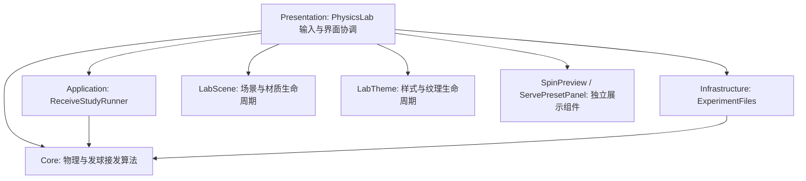

# 项目模块与职责

代码按依赖方向分为四个 Unity 程序集。保留原有 `TableTennis` 命名空间、类名和脚本 GUID，避免移动目录破坏场景引用。

| 目录 | 职责 | 允许依赖 |
|---|---|---|
| `Assets/Scripts/Core` | 飞行、碰撞摩擦、挥拍发球、旋转、预设、接发评估与评分 | .NET；禁止 Unity 引用 |
| `Assets/Scripts/Application` | 后台接发评估的输入快照、进度、取消、异常与完成消费 | Core、.NET；禁止 Unity 引用 |
| `Assets/Scripts/Infrastructure` | 轨迹、碰撞事件、发球与接发报告写入；数字格式与文件命名 | Core、.NET；禁止 Unity 引用 |
| `Assets/Scripts/Presentation` | Unity 生命周期、输入绑定、相机、场景绘制和界面展示 | 以上三个模块、Unity |

前三个程序集通过 `noEngineReferences: true` 强制不依赖 Unity。`Checks/Checks.csproj` 也直接在 .NET 8 下编译、运行这三个模块。

## 对象边界

- `ReceiveStudyRunner` 拥有一个后台任务及其取消资源。启动时复制物理与评估参数；UI 只调用 `Start`、`Cancel` 和 `TryComplete`。取消优先于同时完成的结果，故障与取消不会向 UI 发布新报告。`Dispose` 取消任务，等待任务结束后释放取消资源并观察异常。
- `LabScene` 创建球台、球拍、球和线条，管理场景根节点与材质的释放。它不读取拍型控件，也不启动模拟。
- `LabTheme` 持有界面皮肤、样式和生成纹理；随界面销毁统一释放。
- `ExperimentFiles` 只接收物理数据及已生成的参数 JSON，不引用 `PhysicsLab`。UI 决定导出时机、组装参数快照并展示错误；模块负责文件格式和写入。
- `SpinPreview` 与 `ServePresetPanel` 保持独立对象，分别负责旋转可视化和预设浏览。

`PhysicsLab` 仍是现有 IMGUI 界面的协调组件，partial 文件按功能组织。这里保留输入字段、模式切换、视角及控制点交互；它们不是多个业务模块。新增后台计算、资源创建或文件格式逻辑应放到对应对象中，不再扩充这些 partial 文件。没有为每个类增加接口或继承树。

## 验证与扩展

运行 `sh scripts/check.sh`：原有物理回归，加上任务快照/取消/异常/释放和导出格式检查。Unity 中运行 `LabTools.CheckReceiveWorkflow` 对应的现有接法流程入口，覆盖取消与完成竞态、手调基线和零分结果；其故障注入仅存在于 Editor 测试代码。

现有 `.tools/*/*.csproj` 已更新核心文件路径。所有被移动脚本的 `.meta` 一起移动；场景资源无需重新绑定。历史研究文档中的旧路径是当时记录，当前入口以本文件为准。
